<h1 align="center">
  <picture>
    <source media="(prefers-color-scheme: dark)" srcset="docs/media/readme/brand/wordmark-dark.png">
    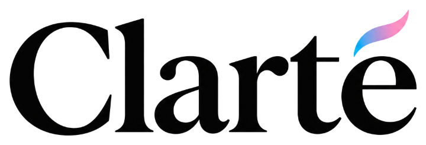
  </picture>
</h1>

**Clarté is for people who have two problems at once: they can no longer speak clearly, and they can't easily use their hands. It lets them say what they want to say. They spell with their eyes, confirm each choice with a small sound, and Clarté speaks the sentence aloud in a ready-made voice or, if they choose, a copy of their own. All it needs is an ordinary laptop with a webcam and a microphone.**

Made at natHacks 2026, in the Healthcare & Accessibility theme.

## Watch it

https://github.com/user-attachments/assets/e22974f3-46f4-4d25-9882-0f3b3130ddf4

78 seconds. Clarté learns where the person is looking, they spell "I want to walk" by looking at groups of letters and making a short sound to choose each one, they pick the word from a short list, and Clarté says the sentence out loud.

## Try it

<p align="center">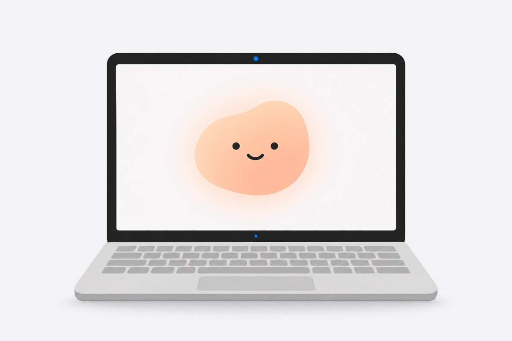</p>

You need a Mac, Windows or Linux computer with a webcam and a microphone, an internet connection, and [Git](https://git-scm.com/downloads). Google Chrome works best.

Open a terminal and run:

```sh
git clone https://github.com/simplythatguy/clarte.git
cd clarte
./clarte ui        # on Windows: clarte ui
```

The first time, this downloads everything Clarté needs (up to about 1.6 GB) and takes a few minutes. Clarté then opens in your browser at http://localhost:5200/. After that it opens in seconds, and word guessing is ready within about a minute. To stop it, press Ctrl+C in the terminal.

- **Voices (optional).** Clarté works as it is, speaking with your computer's own voice. If you want, an [ElevenLabs](https://elevenlabs.io) key gives it a ready-made ElevenLabs voice and lets you make a copy of your own voice. To add one, copy `.env.example` to a new file called `.env` and put your key in it.

## Who it is for

Clarté is for people who live with two things at the same time:

- **Dysarthria.** The muscles used for speaking become weak or hard to control, often after a stroke or a brain injury, or with Parkinson's, multiple sclerosis, ALS or cerebral palsy. Speech becomes slurred, slow or quiet, and strangers often can't understand it.
- **Limited use of their hands.** The same illness or injury often leaves hands weak, shaky or hard to move.

Either one alone has workarounds. Someone whose speech is unclear can type on a phone and let it talk for them. Someone whose hands don't work can speak. Someone with both loses both ways of being understood. That is who Clarté is for.

<p align="center">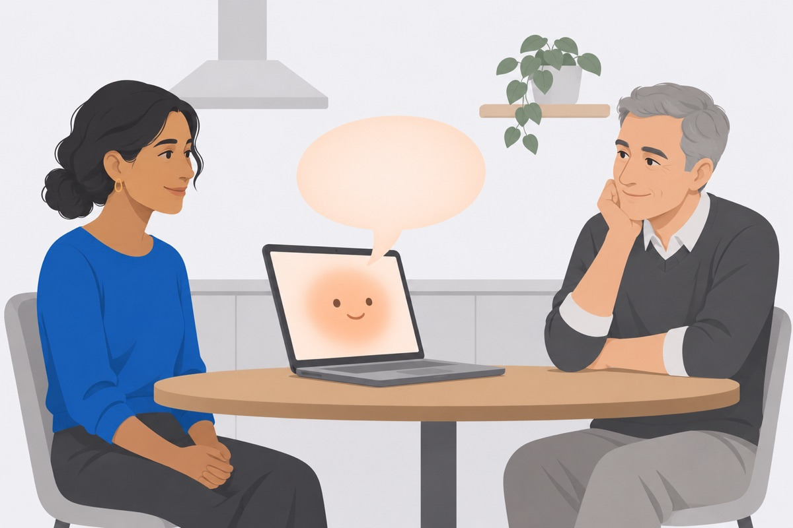</p>

### Julie's story

Julie Tomaino was 38, a choreographer, and her whole life was movement. Then a stroke hit both sides of her brain. For more than a week she couldn't move her hands or her face, and she couldn't make a sound. Only her eyes still moved. When her voice came back, it came, in her words, "slowly, one word at a time." She has said she couldn't get her feet off the floor.

Julie worked hard in rehabilitation and went back to choreographing. Many people don't recover that far. Almost a million people in Canada live with stroke, and up to 4 in 10 have unclear speech after a first stroke.

That is why the sentence in our video is "I want to walk". Julie has no connection to Clarté; we tell her story, from [Heart & Stroke's article "Choreographing her own recovery"](https://www.heartandstroke.ca/articles/choreographing-her-own-recovery), because it shows who Clarté is for.

<details>
<summary>Sources</summary>

[Heart & Stroke, 2024](https://www.heartandstroke.ca/-/media/pdf-files/what-we-do/news/hsf_fast_backgrounder_june_2024.pdf?rev=dadfcd1b3ba1468ba6448168d31bbaea) (almost a million Canadians living with stroke); [Flowers et al., 2013](https://pesquisa.bvsalud.org/bvsms/resource/pt/mdl-23642855) (42% had dysarthria after a first ischemic stroke; another study found 26%, so we say "up to 4 in 10").

</details>

## You may know them

These well-known people lived with the same pairing of unclear or lost speech and hands that wouldn't do what they wanted. None of them used or endorsed Clarté; their stories show who it is for.

<table>
<tr>
<td align="center" width="25%">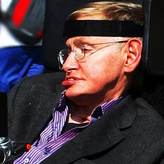<br><b>Stephen Hawking</b><br>ALS</td>
<td align="center" width="25%">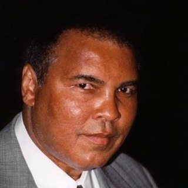<br><b>Muhammad Ali</b><br>Parkinson's</td>
<td align="center" width="25%">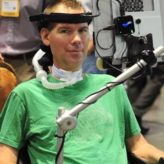<br><b>Steve Gleason</b><br>ALS</td>
<td align="center" width="25%">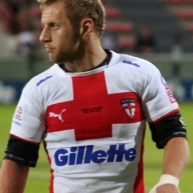<br><b>Rob Burrow</b><br>MND</td>
</tr>
</table>

- **Stephen Hawking** (1942 to 2018), physicist. ALS slowly took the use of his hands, and his speech became so unclear that only people who knew him well could understand him. He wrote by choosing letters and predicted words on a computer, first with a switch in his hand, later with a sensor on his glasses that caught a twitch of his cheek. Clarté's word guessing follows the same idea.
- **Muhammad Ali** (1942 to 2016), boxer. Parkinson's, diagnosed in 1984, made his speech soft and slurred and gave him a strong tremor in his left hand. His hand was shaking as he lit the Olympic flame in 1996.
- **Steve Gleason** (born 1977), American football player. ALS, diagnosed in 2011, took his ability to talk and left him unable to move anything but his eyes. He types by looking at letters on a tablet: a camera follows his eyes, and the tablet speaks for him.
- **Rob Burrow** (1982 to 2024), rugby league player. Motor neurone disease, diagnosed in 2019, took his natural speech and even his ability to use a touchscreen. He spoke by looking at words and letters on an eye-tracking computer, in a recording of his own voice saved before he lost it.
- **Jean-Dominique Bauby** (1952 to 1997), magazine editor. A stroke in 1995 left him fully aware but unable to move or speak; the only thing he could still move was his left eyelid. Someone read the alphabet aloud and he blinked at each letter he wanted. He wrote a whole book this way, *The Diving Bell and the Butterfly*.
- **Jason Becker** (born 1969), rock guitarist. ALS took the use of his hands, then his speech. He spells with his eyes on a board his father designed: one look picks a group of letters, a second look picks the letter. Clarté starts from the same idea of choosing a group of letters with a look.

<details>
<summary>Photo credits and sources</summary>

Photos, cropped and resized, from Wikimedia Commons:

- [Stephen Hawking, 2008](https://commons.wikimedia.org/wiki/File:Stephen_Hawking_in_Cambridge.jpg) by Doug Wheller, [CC BY 2.0](https://creativecommons.org/licenses/by/2.0/).
- [Muhammad Ali, 1997](https://commons.wikimedia.org/wiki/File:Muhammad_Ali_1997.jpg) by John Mathew Smith and celebrity-photos.com, [CC BY-SA 2.0](https://creativecommons.org/licenses/by-sa/2.0/).
- [Steve Gleason, 2016](https://commons.wikimedia.org/wiki/File:Steve_Gleason_(cropped).jpg) by Collision Conf, [CC BY 2.0](https://creativecommons.org/licenses/by/2.0/).
- [Rob Burrow, 2008](https://commons.wikimedia.org/wiki/File:Rob_Burrow.jpg) by Gerard Barrau, [CC BY-SA 3.0](https://creativecommons.org/licenses/by-sa/3.0/).

Sources: [Hawking's own words](https://www.hawking.org.uk/in-words/speeches/speech-1) and the [Science Museum](https://collection.sciencemuseumgroup.org.uk/objects/co8919691); [JAMA Neurology on Ali](https://jamanetwork.com/journals/jamainternalmedicine/fullarticle/2797272) and [CBS News](https://www.cbsnews.com/news/muhammad-ali-parkinsons-disease); [Tulane News on Gleason](https://news.tulane.edu/news/tech-savvy-hero) and the [New York Times via Taipei Times](https://www.taipeitimes.com/News/sport/archives/2016/01/03/2003636313); [Smartbox on Burrow](https://smartboxaac.com/ukie/news/find-out-more-about-rob-burrows-voice/); [TIME on Bauby](https://time.com/archive/6730546/jean-dominique-bauby-a-triumph-of-the-spirit); [New Mobility on Becker](https://newmobility.com/jason-becker/) and [his father's description of the board](https://jasonbecker.com/archive/eye_communication.html).

</details>

## How it works

### 1. Clarté learns your eyes

A dot moves to eight spots on the screen and you follow it with your eyes. This takes about 20 seconds and is saved for next time.

<p align="center">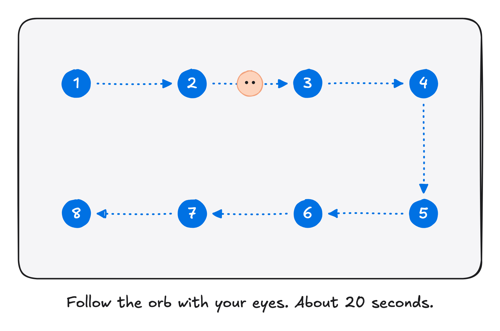</p>

### 2. Look to point

The screen is split into eight large areas, two rows of four. Looking at one draws an outline around it. Looking alone never chooses anything, so you can read the screen freely.

<p align="center">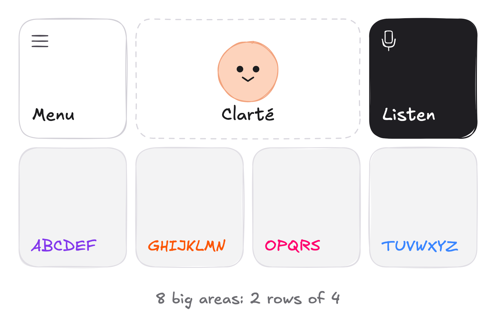</p>

### 3. Make a sound to choose

A short "yeah" or "ah" chooses what you are looking at. Clarté can learn your own sound in about 30 seconds (Menu, then Settings, then My sound), so other people talking, coughs and background noise don't count. Someone who can't make a sound can press an accessibility switch instead.

<p align="center">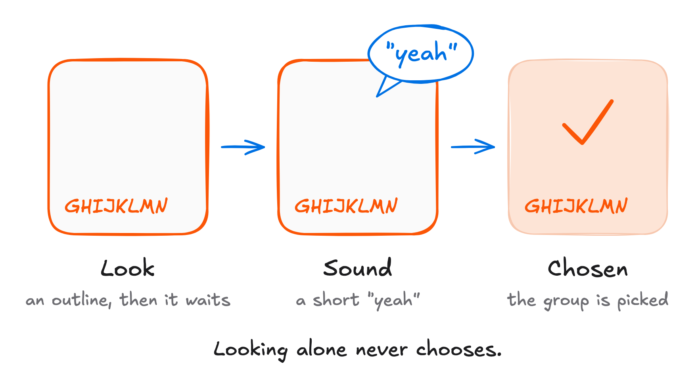</p>

### 4. Spell with four groups of letters

The letters are split into four groups: ABCDEF, GHIJKLMN, OPQRS and TUVWXYZ. For each letter of a word, you choose the group it belongs to. Clarté guesses the word from that pattern, the way a phone's predictive text does. If the guess is wrong, Options shows the other likely words.

<p align="center">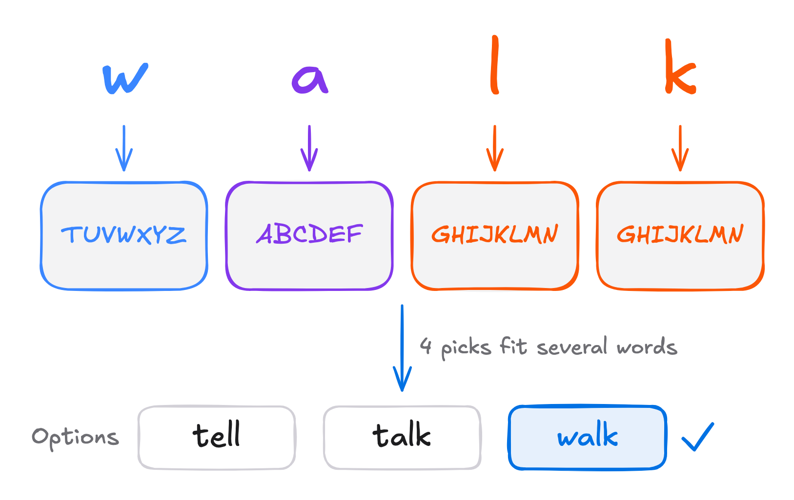</p>

### 5. Speak

When the sentence is ready, Clarté says it aloud.

Two more things help in a real conversation:

- **Listen.** Clarté can turn what the other person says into text on the screen. It uses this to make better word guesses, and it offers a quick reply to greetings and thanks.
- **Your own voice (optional).** Clarté speaks with a ready-made voice from the start, and you can keep it. If you would like, it can also make a copy of your own voice, from old recordings of you from before your speech changed, or from about a minute of speaking today (Menu, then My voice). You can skip this step completely.

<p align="center">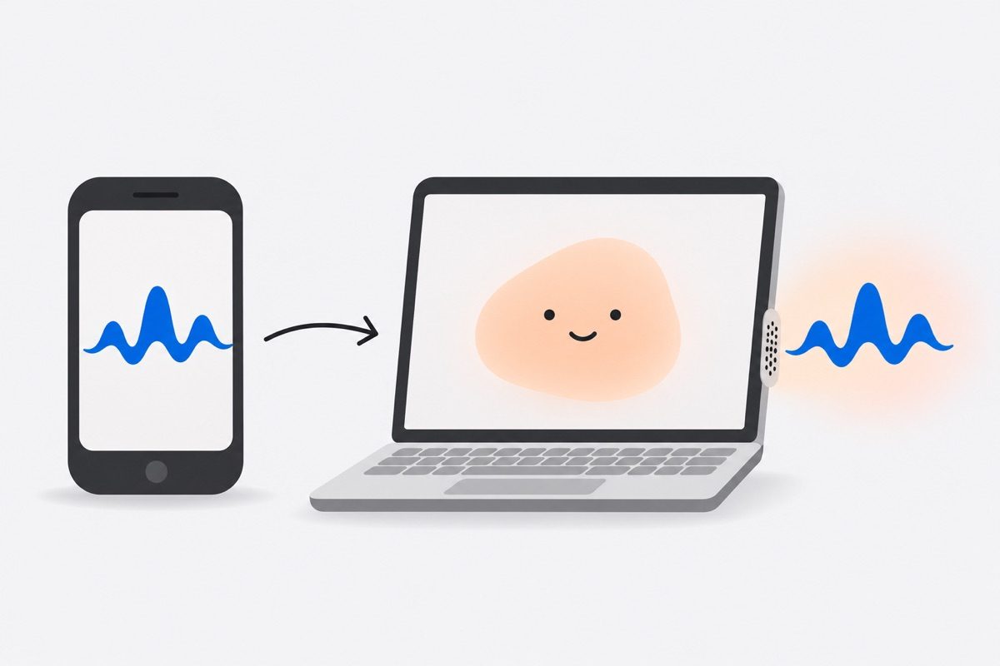<br><em>Optional. You can stay with the ready-made voice.</em></p>

## Why we made it this way

- **Eight big areas instead of a full keyboard.** A laptop webcam can tell roughly where you are looking, but not precisely enough to pick one small key out of 26. Eight large areas are reliable. The cost is that four letter groups can spell more than one word, which is why Clarté has to guess and lets you correct it.
- **Look first, then make a sound.** If looking alone chose things, every glance would type something by accident. Waiting for a sound means you choose only when you mean to. The cost is that you need some way to signal: a sound, or a switch.
- **Word guessing runs on the laptop itself.** It is fast and keeps working without the internet.

## What we have tested, and what we haven't

- **Tested:** the whole journey works on our team's laptops, from learning the eyes to typing and speaking a sentence, as the video shows. We also wrote automatic tests that run the app in a browser with a pretend camera and microphone, and check every screen.
- **Not yet tested:** we have not yet tried Clarté with people who have dysarthria. That is the most important next step.
- **Known limits:** eye tracking gets worse when you move or slump in your chair, or when the lighting changes. Choosing by sound only suits people who can make a short, steady sound, or who can press a switch instead.
- Clarté is a prototype, not a medical device.

## What stays on your computer

<p align="center">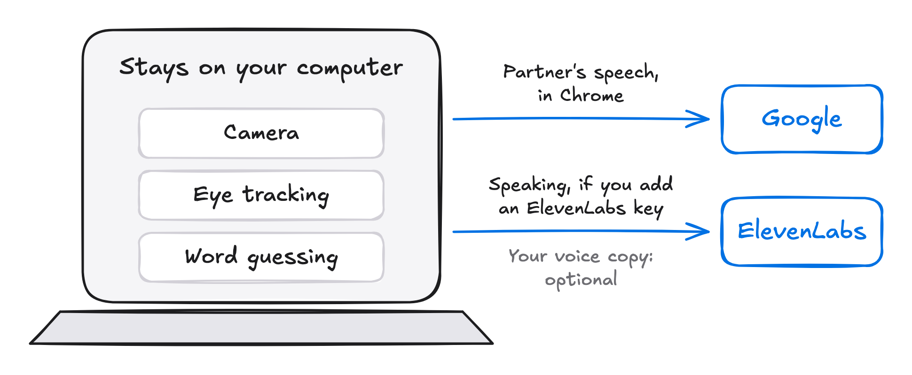</p>

- **The camera.** The images are used on your computer to work out where you are looking, and are not sent anywhere.
- **Word guessing** happens on your computer.
- **Listening to the other person.** In Google Chrome this uses Google's speech service, so that audio goes to Google, and Clarté shows "Via Google" while it does. If Google's service isn't available, for example without internet, the listening happens on your computer instead.
- **Speaking.** Without an ElevenLabs key, Clarté speaks with your computer's own voice. If you add a key, it speaks through ElevenLabs, a voice company, so the text of each new phrase goes there, whichever voice you use.
- **A copy of your own voice (optional).** Only if you choose to make one, the recordings Clarté picks are sent to ElevenLabs to make it.

## What's next

<p align="center">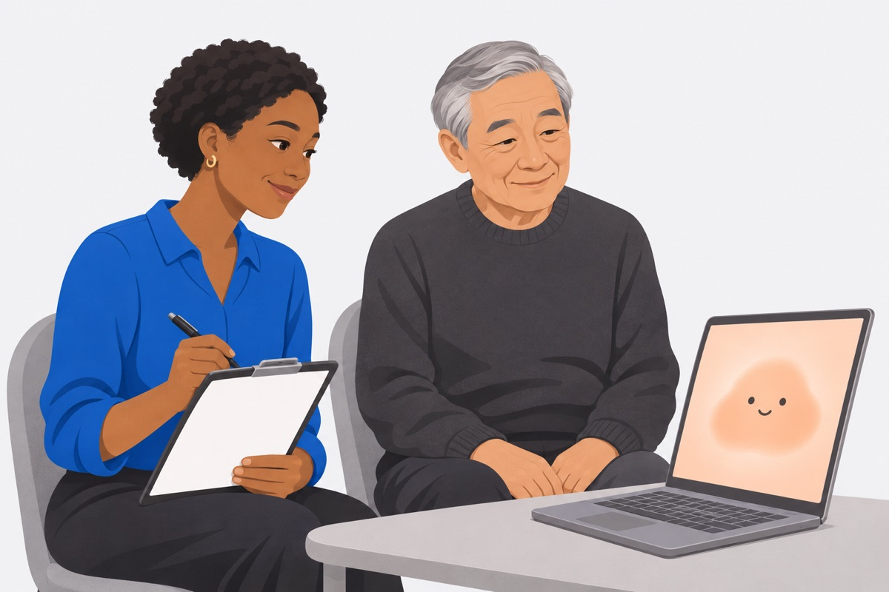</p>

Our plan for the nine months after natHacks:

- **Months 1 to 3:** ask speech-language pathologists for advice, and test Clarté with people who have dysarthria.
- **Months 4 to 6:** make eye tracking hold up when people move, and make fixing a wrong word quicker.
- **Months 7 to 9:** longer trials in everyday conversations.

We will measure how many messages come out as the person meant them, how long each one takes, how often they have to correct a word, how often something is chosen by accident, and how tiring it is.

## What's in this repository

| Folder | What it holds |
| -- | -- |
| [`app/`](app/DESIGN.md) | The Clarté app you see on screen |
| [`engine/`](engine/README.md) | The word guesser |
| [`voice/`](voice/README.md) | The part that speaks with ElevenLabs voices, and makes a copy of your own voice if you want one |
| [`docs/`](docs/developers.md) | Technical details, design notes and research |
| `skills/`, `AGENTS.md`, `CLAUDE.md` | Instructions for the AI coding assistants we used while building Clarté |

Developers: start with the [developer guide](docs/developers.md).

## Credits

Clarté builds on other people's work:

- **Eye tracking:** [WebEyeTrack](https://github.com/RedForestAI/WebEyeTrack) (MIT licence), which uses Google's [MediaPipe](https://ai.google.dev/edge/mediapipe) and [TensorFlow.js](https://www.tensorflow.org/js) (Apache 2.0).
- **Word guessing:** [SmolLM2](https://huggingface.co/HuggingFaceTB/SmolLM2-135M) from Hugging Face (Apache 2.0), trained further by us on everyday conversation, including the [DailyDialog](http://yanran.li/dailydialog) dataset (for non-commercial use). Word lists come from [wordfreq](https://github.com/rspeer/wordfreq), from [Wiktionary](https://en.wiktionary.org) through [kaikki.org](https://kaikki.org) (CC BY-SA 4.0), and from the 2010 US Census surname list.
- **Hearing the other person:** OpenAI's [Whisper](https://github.com/openai/whisper) (MIT licence) when listening happens on the computer, and Google's speech service in Chrome.
- **Voice:** [ElevenLabs](https://elevenlabs.io) speaks the ready-made voice and, if you make one, your voice copy, and [Resemblyzer](https://github.com/resemble-ai/Resemblyzer) checks that recordings are of the right person.
- **Sound tests:** recordings from the [CNVVE dataset](https://doi.org/10.18419/darus-3898) (CC BY 4.0).
- **Lettering:** the [Atkinson Hyperlegible Next](https://www.brailleinstitute.org/freefont/) typeface from the Braille Institute, designed to be easy to read.

The detailed licence notes are kept next to each part, for example [`engine/README.md`](engine/README.md) and [`app/fixtures/listen/SOURCE.md`](app/fixtures/listen/SOURCE.md).

Clarté's own code is under the [MIT licence](LICENSE).

<p align="center">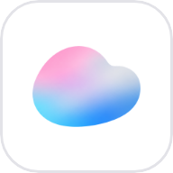</p>
